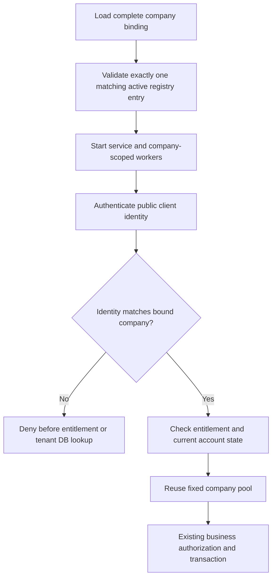
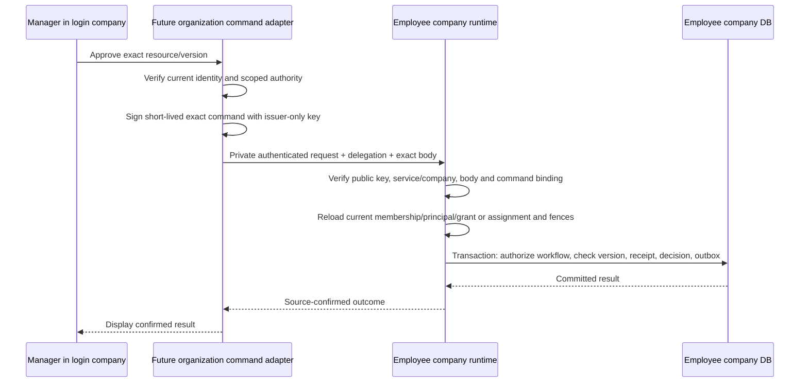

# Company runtime and delegated-command security

> Historical phase snapshot. For the implemented workspace, command/event flows and current release gates, use [Organization workspace handoff](organization-workspace.md). Statements below about unavailable later features describe that earlier phase only.

Implementation phase: fixed company database selection and internal command authentication primitives. This phase does not expose organization APIs or activate cross-company approvals. See [architecture v5](../architecture/2026-10-18-organization-cross-company-management.html) and [progress](../superpowers/plans/2026-10-18-organization-progress.md).

## Fixed company runtime

Configure these three variables together through the deployment's secret/configuration mechanism:

| Variable | Meaning |
| --- | --- |
| `KABIPAY_BOUND_TENANT_ID` | Non-nil ID of the one company this process serves |
| `KABIPAY_BOUND_DATABASE_URL` | PostgreSQL URL using this company's database role; explicit host, username and database path |
| `KABIPAY_BOUND_SCHEMA` | Exact registered company schema, at most 63 ASCII identifier characters |

All absent retains existing unbound behavior. Partial, blank, invalid UUID/URL/schema, reserved schema, or unknown URL query parameters fail startup. Company deployments for this feature must configure the binding explicitly. This is not a fleet-wide enforcement switch.

The URL supports `postgres`/`postgresql`, standard TLS options (`sslmode`, certificate/key/root certificate and their supported hyphen aliases), `application_name`, and `statement-cache-capacity`. Connection-coordinate overrides in query parameters are rejected. Put the host, port, username and database in the URL itself. An omitted port means 5432. Set the desired TLS policy in this URL; it does not inherit `POSTGRES_SSLMODE` rewriting. SQLx options are parsed once at startup and retained privately, including any supported PostgreSQL environment defaults resolved then. Reconnection does not re-read the URL or process environment. Diagnostics omit the URL and credentials.

Startup verifies exactly one active `POSTGRES` registry entry for the bound company, with matching host, database and schema. Registry host aliases must match the configured URL host; Docker/loopback rewrites are not used. Mapping changes require deliberate reconfiguration/restart. This startup check does not establish a per-request registry revocation mechanism; current company/activity/grant checks remain required for commands.

After startup, resolution rejects a different company ID before reading cached handles, querying the registry or opening a tenant pool. The configured company uses only its fixed options, with the existing bounded pool and per-checkout search path. Registry-selected and scaffold connections cannot override this path. The shared GraphQL boundary also rejects foreign-company clients, development-header identities, anonymous requests and operator tokens before entitlement/database work. Existing same-company active-account and entitlement checks remain in place.



Wiring covers shared subgraph startup, standalone Auth/Employee/Notification startup, outbox worker, Employee Finance worker, Payroll reconciliation worker, attendance backfill and tenant-import target selection. Worker company enumeration is filtered before fetching its registry page. The ops service rejects company binding configuration. Central authentication has separate control-plane responsibilities; its tenant cache honors the binding but this phase does not redesign its operator endpoints.

## Dedicated deployment identities remain required

Application guards cannot prevent an administrator or compromised process from using credentials it already possesses. Before production rollout:

- Assign each company runtime a restricted PostgreSQL login and fixed secret. Revoke inherited `PUBLIC` database CONNECT where needed; grant access only to the required company database/schema and operations. Use a separate migration owner, no superuser/owner credentials in runtime processes.
- Give control-plane reads a separate restricted identity through the existing `DATABASE_URL` configuration. Entitlements, business clocks and current service startup still depend on the control plane. Review every reachable operation before reducing its privileges. Do not place fleet-wide tenant credentials in `POSTGRES_*`, mounted files or secret-store permissions.
- Apply network and secret-store access restrictions. Separate DBs on one PostgreSQL server still require explicit role grants; a fixed URL alone provides no physical isolation.
- Migrate the existing browser JWT trust distribution before claiming service-compromise isolation. Current browser JWTs share `KABIPAY_JWT_SECRET` and use HMAC; a service holding that secret can mint browser tokens. The dedicated RSA delegation verifier does not change that existing contract. The future browser issuer must retain signing authority and runtimes receive verification-only keys, with compatibility/rotation acceptance.
- Route target-company commands through authenticated private service routes and verify target service identity, TLS, tenant binding and live source authorization. No such new route is enabled by this phase.

The disposable test proves restricted-role behavior in its own synthetic PostgreSQL installation. Real deployment roles, routing, secrets, TLS and network policy are unverified.

## Delegated-command contract

`kabipay-organization-security` supplies a separate issuer/verifier API. No signing-key environment loader, token-issuing endpoint or command endpoint is registered yet. Private signing keys belong only to the future trusted organization issuer; company runtimes receive public keys indexed by configured key ID. The included PEMs are deliberately public synthetic test fixtures and must never be deployed.

The verifier requires RS256, issuer `kabipay-organization-delegation`, type `hrms-delegation+jwt`, a known key ID and exact target service/company. It checks issuance/not-before/expiry with zero clock leeway and a maximum lifetime of 300 seconds. Synchronize host clocks. It also validates non-nil identities, positive versions, canonical capability/resource names, and a SHA-256 body digest.

Each token identifies the global principal, original login company/user, organization and target membership, authority kind/reference/version, resource/version, capability, command ID and token ID. The command adapter supplies its own expected resource, capability, version, command ID and hash of the exact received body bytes. It must derive these expectations from its protected route and request; do not copy expectations from the token itself. Never include full employee records, sensitive reasons or browser JWTs in delegation claims or logs.

`VerifiedDelegation` has private state and a read-only claims accessor. It authenticates attribution; it does not create a target-company employee or authorize the action by itself.



Only the cryptographic verification primitives and fixed DB resolution in this diagram are implemented here. The issuer authorization adapter, private transport, fresh-policy reader, receipt/decision transaction and source outcome transport are subsequent work. The source company must fail closed when current authority cannot be verified, has changed or has been revoked, even if a token remains cryptographically valid.

For retries, keep one stable command ID for the same operation and persist a transactional receipt tied to the principal, target, resource, expected version and body hash. Identical retries return the prior outcome; conflicting command-ID reuse must fail. Token expiry and RSA signatures alone do not prevent replay or provide idempotency. A new token ID must not bypass a command receipt.

For key rotation, distribute the new public key to intended verifiers before switching the issuer's active key ID. Keep the previous public key through the last old token's validity plus the defined delivery window. After removal, unknown/retired key IDs fail closed. Never retrieve a key from a URL supplied by the incoming token. A compromised key requires immediate removal and policy revocation; do not extend token lifetime to repair delivery problems.

## Focused checks and evidence

From `hrms-svc`, using existing locked dependencies:

```powershell
cargo test -p kabipay-common --lib --offline -- --test-threads=1
cargo test -p kabipay-organization-security --offline --target-dir target/organization-foundation
cargo clippy -p kabipay-organization-security --all-targets --offline --target-dir target/organization-foundation -- -D warnings
cargo check -p kabipay-auth -p kabipay-employee -p kabipay-notification -p kabipay-outbox-worker -p kabipay-tenant-import -p kabipay-payroll -p kabipay-attendance --all-targets --offline
powershell -NoProfile -File scripts/test-bound-runtime.ps1
```

The PowerShell fixture precompiles its ignored test, then creates a uniquely named, loopback-only disposable PostgreSQL 16 container using an already available `postgres:16-alpine` image. It loads no deployment `.env` or existing database. Synthetic roles/database markers prove fixed resolution, wrong-company rejection and PostgreSQL denial of cross-database CONNECT. Synthetic registry edits prove startup denial for mismatched/unsupported/inactive/duplicate mappings. It restores its process variables and removes only its own container. `-Prepared` skips only the initial precompile when that exact fixture test is already built; Cargo still checks freshness.

Recorded results: 88 common tests, 9 delegated-security tests, the disposable PostgreSQL scenario and all-target compilation of the seven affected packages passed. The security crate passes Clippy with `-D warnings`. The same strict Clippy check for the existing common library reports nine findings in unchanged `error.rs`, `middleware.rs`, `workflow_approval.rs` and `working_calendar/writes.rs`; common-library Clippy is not clean. See the progress ledger for commands and scope.

Keep the temporary business outbox, command receipts, existing webhook/Finance delivery paths and audit readers until the planned Kafka/CDC/ClickHouse cutover and reconciliation gates are complete. This phase changes no database schema and removes no business/history records.
