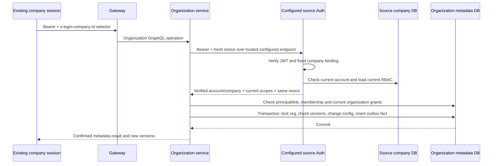

# Organization metadata service

> Historical phase snapshot. For the implemented workspace, command/event flows and current release gates, use [Organization workspace handoff](organization-workspace.md). Statements below about unavailable later features describe that earlier phase only.

This phase adds a separate GraphQL control plane on default port **4031**. It manages identities, company membership and scoped roles. Company business databases remain separate. Cross-company approvals, target grant installation, UI and the Kafka/ClickHouse pipeline are not enabled by this phase.

## Identity and data flow



The source selector chooses only an administrator-configured Auth endpoint. It is not proof of company/person identity. The returned verified company must match it. Principal and role headers are never accepted as authority. The organization service holds no browser signing secret and has no tenant database cache, registry-selected DSN or fallback connection.

POST `/auth/client/organization-identity` verifies the existing client JWT and checks its bound company before database work. It then verifies current tenant/account eligibility, denies incomplete password setup, and loads current RBAC instead of trusting permission claims in the JWT. Responses use `Cache-Control: no-store`. A new nonce and live call are required for each authenticated organization HTTP request; successful identity responses are not cached. Introspection remains available anonymously, while business resolvers reject anonymous requests.

This reuses the existing browser token contract. Browser HMAC signing-key distribution, source Auth credentials, TLS/network controls and actual deployed least privilege still require production acceptance. The organization process must not receive fleet/company secrets merely because it does not use them.

## Startup configuration

The new organization binaries intentionally do **not** load a shared `.env` file.

| Variable | Purpose |
| --- | --- |
| `KABIPAY_ORGANIZATION_DATABASE_URL` | Required explicit PostgreSQL metadata URL, with host/username/database. Dedicated runtime DB role; no `DATABASE_URL` or tenant fallback |
| `KABIPAY_ORGANIZATION_IDENTITY_ENDPOINTS` | Required JSON object mapping company UUIDs to their trusted source Auth `/auth/client/organization-identity` URLs |
| `KABIPAY_ORGANIZATION_PORT` | Listen port; default 4031 |
| `KABIPAY_ORGANIZATION_ENABLED` | Gateway opt-in: `true` adds organization to configured subgraphs; default absent/false leaves the current fleet unchanged |

Auth endpoints require HTTPS, except numeric loopback HTTP for isolated local use. User-info credentials, query strings, fragments and other URL paths are rejected. Redirects and proxies are disabled; request timeout is five seconds and response body limit 64 KiB. The organization GraphQL body limit is 64 KiB, with depth/complexity limits and a bounded execution timeout. Do not expose the source identity route through a cache or response-rewriting intermediary.

The existing Auth service must have its company binding and current identity route deployed before enabling the organization endpoint map. A shared trusted Auth deployment may serve multiple companies under its existing control-plane contract; a company-bound Auth deployment serves only its configured company. Endpoint ownership is deployment configuration, not an HR-editable arbitrary URL/SSRF feature.

The gateway uses its existing subgraph host/base URL configuration for port 4031. It forwards `authorization` and `x-login-company-id`, not asserted organization roles/principal IDs. TypeScript checks and header/config tests do not establish actual stitched-schema or browser acceptance.

## First organization and subsequent administration

1. An operator reviews ownership and runs the `bootstrap_organization` binary under a separately authorized metadata database identity. It takes company UUID and organization name as arguments. Supply the current source access token through `KABIPAY_ORGANIZATION_BOOTSTRAP_TOKEN`, without the `Bearer` prefix; never put it in command history or logs.

   The normal organization runtime login intentionally cannot insert an organization or bypass invitation defaults. Run bootstrap in a separate, disposable operator process with its own verified metadata connection. Keep the operator database credentials and source token in memory, pass them through protected process input/environment, and remove the process after completion. Do not add bootstrap privileges or operator credentials to the running organization service.
2. Bootstrap independently verifies that the source account has current local `role:manage` at `ALL` scope. It locks the source company, rejects existing occupied membership, and atomically registers the verified account if needed, creates the organization/company and central administrator binding, and writes configuration facts. Any failure rolls everything back. No public GraphQL bootstrap operation exists.
3. Other accounts explicitly call `registerOrganizationIdentity`. A verified source account tuple receives one principal and verified login link; repeated registration reuses it. Matching names/emails never merge people. A revoked/disabled identity is not silently recreated.
4. A central administrator invites a company. Membership stays `PENDING`. A currently authenticated account from that company with local `role:manage` at `ALL` scope accepts the invitation using its membership/organization IDs and expected versions. Acceptance creates no organization administrator grant by itself.
5. An administrator with explicit `organization:delegate` creates supported role capabilities and binds a verified participating principal to explicit company memberships. Ordinary local HR rights grant no central administration authority.

The invitation ID and expected versions are returned to the administrator by the invite mutation. Delivery and a source-company invitation inbox are not implemented yet; the accepting administrator must receive those details through the reviewed onboarding process. An organization configuration query requires existing administration authority and cannot serve as an invitation discovery bypass.

### Central metadata versus tenant business authority

`organization:manage` permits **organization-wide configuration** and configuration reads, once its live principal/source membership and at least one explicit active company scope are eligible. `organization:delegate` additionally permits role/capability/binding changes; those operations also require `organization:manage`. These are sensitive organization administrator capabilities, not company-limited HR roles. The selected company scopes provide active membership anchors for these central capabilities; they do not restrict which configuration rows the administrator can administer.

Tenant business capabilities, such as `payroll:manage` or `leave:approve`, retain explicit target company/employee scopes. Creating a role does not execute any such action. If a role contains any business capability, its new binding/company scopes stay `PENDING` until the later target-company installation/fence protocol exists. Central metadata-only roles may activate immediately because their policy is owned by this service. Use separate metadata and business roles: a mixed role remains pending in its entirety. No current tenant workflow consumes these grants.

Role capabilities are configurable subsets of the server's supported catalog. Unknown/wildcard/duplicate capability codes are rejected. Catalog evolution is a code/contract change; company configuration and role names are data. No company name or tenant UUID is hardcoded.

### Versions and revocation

Every configuration mutation requires the current organization version; resource updates also require the resource version. Concurrent changes serialize and stale edits fail without partial writes. Reload before intentionally retrying a conflict. These are versioned configuration edits, not the durable idempotent approval-command protocol planned for later.

Role replacement increments role/binding versions and invalidates applicable grant scope versions. Revoked company scopes remain revoked. Binding revocation immediately revokes its company scopes centrally. Company suspension immediately denies source-company administration and revokes that membership's scopes. Existing positive browser claims cannot override those current metadata checks.

Self-granting, editing one's own assigned role, revoking one's own binding and suspending one's login company are rejected. Another authorized administrator or the later operator recovery process must perform those changes. Automatic company resume/detachment and identity reassignment are not supplied here.

`revokeMyOrganizationIdentity` acts on the currently verified source account's global login link only, using its expected version. An organization administrator cannot revoke someone else's global identity across unrelated organizations. Re-registration does not undo revocation. Account merging/recovery requires a separate proof/reassignment protocol.

## API surface

Queries:

- `myOrganizations`, `myOrganizationIdentity`, `organizationCapabilityCatalog`.
- `organizationConfiguration(organizationId, kind, after, first)`, with `COMPANIES`, `ROLES` or `BINDINGS`, page sizes 1-100, stable UUID cursor, organization version and version-1 JSON documents. These are configuration records, not employee/private HR data. Role records contain capabilities; bindings contain explicit company scopes.

Mutations:

- `registerOrganizationIdentity`, `revokeMyOrganizationIdentity`.
- `inviteOrganizationCompany`, `acceptOrganizationCompany`, `suspendOrganizationCompany`.
- `createOrganizationRole`, `replaceOrganizationRoleCapabilities`.
- `grantOrganizationRole`, `revokeOrganizationRoleBinding`.

Use schema introspection for exact typed arguments. No generated UI queries or navigation were changed in this phase.

## Database and history

Existing foundation migration 0111 supplies metadata structures. Additive ops migration **0113** creates `kabipay_ops.organization_outbox`: event ID, organization/source/actor, aggregate ID/version, event/schema type, configuration payload and commit timestamp. It has no polling status, retry history or generic log archive. Registration, bootstrap, metadata changes and identity revocation write facts transactionally; source bearer tokens/passwords and employee business records are never stored in these events.

The payload records the requested configuration change and resulting IDs/status/versions with original source attribution. This is the control-plane configuration-fact schema; the future CDC/event adapter must publish a reviewed versioned envelope and reconcile coverage before history cleanup. No Kafka publishing or ClickHouse ingestion is claimed here. There is no outbox cleanup before capture/replay acceptance, so monitor retained volume if piloting it. Existing tenant outbox/history/delivery paths are retained.

Do not apply this migration to an existing database without the normal reviewed release process. Fixture validation executes forward SQL directly; it is not a full Liquibase upgrade/rollback/restore or deployed privilege test.

## Focused verification

From `hrms-svc`:

```powershell
cargo test -p kabipay-organization --offline
cargo test -p kabipay-auth organization_identity --bin kabipay-auth --offline
cargo check -p kabipay-auth -p kabipay-organization --all-targets --offline
cargo clippy -p kabipay-organization --all-targets --no-deps --offline -- -D warnings
node scripts/test-organization-control.cjs
```

The ignored PostgreSQL scenario runs only through the disposable fixture. It uses the already available PostgreSQL 16 image, unique loopback container, synthetic credentials, a stub source Auth server and no deployment `.env` or existing database. `--baseline` intentionally omits migration 0113 and fails. `--prepared` skips initial compilation only; Cargo still checks freshness. Each run removes its own container. The source Auth tests separately exercise eligibility and early bound-company rejection; the stub does not prove the full real Auth/database/organization HTTP deployment chain.

From `hrms-gateway`, focused tests are the subgraph/header tests and TypeScript compilation. The full gateway unit suite can also run through its existing test command.

See [execution evidence and review rulings](../superpowers/plans/2026-10-18-organization-service-progress.md). Remaining milestones include invitation delivery, account merging, tenant acknowledgements/security fences, source-owned approvals and hierarchy, UI, Kafka/CDC/ClickHouse, safe lifecycle drain/cleanup and production acceptance.
