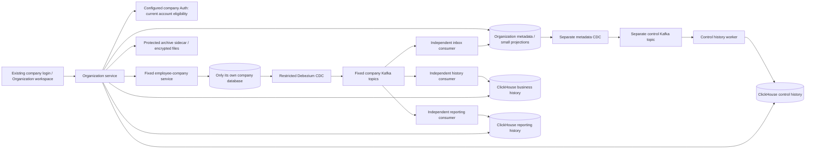

# Organization workspace: implementation and release handoff

Current architecture: [interactive HTML and database relationships](../architecture/2026-10-18-organization-cross-company-management.html). Implementation remains uncommitted on `feat/organization-cross-company-management` in the service, database, gateway, UI and documentation repositories. This document supersedes the earlier phase-only service/runtime descriptions for feature availability.

## User flow

1. HR signs in to the company that employs them. Ordinary local HR permissions continue to apply only there.
2. An explicitly granted organization administrator opens **Organization workspace** in that same session. Organization configuration rights and company business rights are separate capabilities; payroll needs its own explicit target-company grant.
3. The operator bootstraps the first organization after ownership review. HR invites other companies; an authorized account from each company accepts. HR installs each company fence and synchronizes its directory. An accepted invitation alone does not enable business commands.
4. HR configures company-scoped roles and effective-dated reporting assignments. A person can manage reports in several companies, and employees in either company can report across company boundaries. The central graph rejects person-level cycles, including transitions, pending installation and future intervals.
5. Each employee's own company installs the exact approved configuration and acknowledges its version/hash. Current source policy and the local installed fence must agree before execution. Standard employee screens show the canonical manager and prevent conflicting local edits.
6. Managers see purpose-limited cross-company requests in their workspace. Opening details and approving, reviewing or submitting feedback calls the employee's company service with a short exact-command delegation. That service applies its existing workflow, entitlement, version and business validation in its own database.
7. An uncertain response stays **Awaiting confirmation**. The original command ID resolves its source receipt. Cancel-if-uncommitted serializes against that same ID: it returns an existing committed result, or records a cancellation receipt that blocks late execution. A cancelled command requires a new source read and a new command ID for a new attempt.
8. Owners with explicit analytics/history grants see company totals, freshness and coverage. Unknown, incomplete or stale data is shown explicitly; missing data is not a zero. Configuration activity is observed metadata with `NOT_ATTESTED` coverage, rather than a claim of complete historical evidence.

### Delivered operation boundaries

| Area | Available workspace operation |
| --- | --- |
| Organization administration | Company invitation/acceptance, membership installation and lifecycle, supported roles/capabilities/company grants, directory sync, relationship proposal/replacement/end and source installation |
| Manager work | Company-labelled team/inbox, protected leave and timesheet detail/decision, continuous feedback, appraisal detail/submission |
| Company HR administration | Source employee list/detail/create/update/status and real login provisioning; source account list/create/update/access/roles; typed workflow definitions/activation; separation initiation/detail/rejection/cancellation and clearance. Explicit ALL employee/account/workflow/onboarding grants are separate. Finance approval and FNF remain separately authorized. |
| Shared payroll | Separate collection and cycle-detail reads; durable source-owned draft/finalization jobs with existing payroll rules, fresh execution authority, current revision/fingerprint and required employee acknowledgements; protected job status and queued-only cancellation |
| Owner reporting | Exact logged/approved time, attendance with nullable observed durations, whole-request leave centidays and project time; whitelisted business history, per-company accepted coverage and source/CDC/all-consumer partition barriers |
| Protected history lifecycle | Resumable genuine source history export, encrypted immutable archives with current scoped retrieval, accepted cutover and bounded evidence-gated company/control outbox cleanup (default dry-run) |
| Recovery | Reload-safe status-only references, exact receipt reads and source-fenced cancel-if-uncommitted |

The command enum remains a closed typed allowlist, never an arbitrary SQL/GraphQL proxy. Employee/account forms exclude bank/tax/private profile fields and arbitrary account relinking. A real target employee login is provisioned by the existing source onboarding transaction under role:manage; foreign managers/HR never receive fake target accounts. Credential-bearing payloads remain request-only; reload recovery stores references, not passwords. Automatic multi-company payroll scheduling and queued manager business commands are optional future products, not implied by this implementation. Project time is not a productivity or task-completion measure.

## Data ownership and flow

Shared organization and event services receive no company database credentials. Every source service has one deployment-bound company and a restricted database login. Endpoint maps, broker topics and identity keys are deployment configuration; HR cannot enter a database URL or arbitrary service endpoint.

Canonical business facts use a compact transactional outbox. CDC publishes only committed rows; each inbox/history/reporting group acknowledges its own work independently. A ClickHouse outage does not block inbox ingestion. Source markers, persisted Connect offsets and all-role/all-partition barriers establish current coverage; worker uptime alone does not. Receipts, payroll jobs and business decisions remain source-owned. Kafka handles delivery/replay, ClickHouse retains canonical history, and an allowlisted collector exports redacted diagnostics separately. Logs cannot replace transactional receipts or the atomic business-to-event handoff.

Known inactive company memberships retain authenticated delayed facts in history but do not update current inbox/directory projections. Unknown or merely pending organization/company pairs are quarantined without retaining their source bodies. Historical retention grants no current application access. Rejoining/resuming requires fresh capture acceptance before complete-reporting claims.

## Additive database changes

| Migration | Database | Responsibility |
| --- | --- | --- |
| 0111 | Operations/organization metadata | Organizations, configurable company membership, principals/login links, employment references, roles/company scopes, relationship reservations |
| 0112 | Each company | Canonical local assignments, source actors and management capabilities |
| 0113 | Operations/organization metadata | Compact transactional control outbox |
| 0114 | Operations/organization metadata | Directory synchronization, installed snapshots/readiness, graph revisions, minimal immutable command intents and event sequences |
| 0115 | Each company | Installed grants, command receipts, principal attribution, source versions/facts and bootstrap/review-manager triggers |
| 0116 | Operations/organization metadata | Purpose-limited projections, version/hash guards, capture acceptance/watermarks and restricted membership classification |
| 0117 | Each company | Membership installation/fences and safe suspension/detachment lifecycle |
| 0118 | Each company | Account/workflow/exit resource versions, actor attribution and source administration guards |
| 0119 | Each company | Immutable payroll job intent, state/lease/retry/version and transaction/commit fencing |
| 0120 | Operations/organization metadata | Independent consumer identities/checkpoints, source capture markers/barriers, archive manifests/access audit, accepted retention/cutover policy/evidence |
| 0121 | Each company | Expanded fact snapshots/capture markers, resumable genuine history export, source administration/job events and immutable cleanup receipts |
| 0123 | Operations/organization metadata | Original intent identity/link epochs and ACCEPTED queue-receipt state; old unknown epochs remain unknown |

Review the migration XML and forward/rollback implications together. Disposable fixtures execute actual forward SQL over generated source schemas. They do not establish a full existing-database Liquibase upgrade, rollback or restore.

## Deployment configuration

Keep the feature disabled until the following identities and infrastructure are accepted. Existing nonparticipating deployments remain opt-in compatible.

| Process | Required configuration group |
| --- | --- |
| Source Auth and business services | `KABIPAY_BOUND_TENANT_ID`, `KABIPAY_BOUND_DATABASE_URL`, `KABIPAY_BOUND_SCHEMA`; restricted control-plane reads through existing `DATABASE_URL` where required |
| Client authentication | `KABIPAY_CLIENT_JWT_MODE=rs256`, `KABIPAY_CLIENT_JWT_PUBLIC_KEYS`; only the bound Auth issuer receives `KABIPAY_CLIENT_JWT_KEY_ID` and `KABIPAY_CLIENT_JWT_PRIVATE_KEY_FILE` |
| Organization service | Explicit `KABIPAY_ORGANIZATION_DATABASE_URL`, fixed `KABIPAY_ORGANIZATION_IDENTITY_ENDPOINTS`, `KABIPAY_ORGANIZATION_EXECUTION_ENABLED=true`, fixed `KABIPAY_ORGANIZATION_RUNTIME_ENDPOINTS` |
| Delegation | Organization-only `KABIPAY_ORGANIZATION_DELEGATION_KEY_ID` and private-key file; source verification-only `KABIPAY_ORGANIZATION_DELEGATION_PUBLIC_KEYS` |
| Private service proof | Exact `KABIPAY_SERVICE_ID`, key ID/private-key file and `KABIPAY_SERVICE_TRUST_KEYS`; each company/service uses a distinct key |
| Source live policy | Fixed `KABIPAY_ORGANIZATION_POLICY_URL`; TLS/private routing and trusted service keys |
| Read-only reporting | Fixed `KABIPAY_ORGANIZATION_CLICKHOUSE_URL`, user/password file, optional CA file; dedicated restricted history reader |
| Archive client | Fixed `KABIPAY_ORGANIZATION_ARCHIVE_URL`, CA file and HTTPS client certificate/key files; exact RS256 service proof. Encryption keys belong only to the archive sidecar. |
| Gateway and UI | `KABIPAY_ORGANIZATION_ENABLED=true` and `VITE_ORGANIZATION_ENABLED=true` after services/schema/configuration are ready |

Exact JSON formats and parser validation live in `kabipay-common/src/client_jwt.rs`, `kabipay-organization-security/src/config.rs` and `kabipay-organization/src/execution.rs`. The source fixture demonstrates synthetic configuration; its keys, URLs and credentials must never be copied to deployments. Run `infrastructure/organization/validate-keys.mjs` against a reviewed public-key manifest to reject canonical RSA-key reuse across purposes, companies or services. Do not print private keys, browser tokens, environment files or database credentials.

Client RSA is mandatory for the organization execution path. Positive token claims never replace current account, principal, membership, installed version, company scope or resource authorization. Use separate migration owners and runtime roles, revoke unwanted PostgreSQL `PUBLIC CONNECT`, and deny shared services access to company secrets. Fixed routing alone is not a substitute for database/network isolation.

## Lifecycle and recovery

- **Suspend:** central business access stops immediately; source installation drains its existing transactions and installs the paused fence. Existing manager snapshots and history remain for safe recovery.
- **Resume:** install the new membership revision, reinstall still-authorized company grants, synchronize the directory and accept fresh capture coverage. Revoked grants do not silently reactivate.
- **Detach:** first reassign/end reports in other companies and obtain their source acknowledgements. Install the terminal source fence, restore real local legacy management where applicable, end source-owned assignments and retain receipts/history. Detachment is final only after source acknowledgement.
- **Manager replacement:** change the existing assignment revision atomically and install it. Do not end the old assignment as a shortcut that temporarily restores legacy fallback. Unconfirmed installation reserves the graph until exact recovery/acknowledgement.
- **Authority changes:** old receipt disclosure remains bound to its original authority. Obsolete pending references are pruned after a complete current-authority refresh; the UI discards their private payloads and requires a fresh source read. This does not infer an old business result.
- **Lost response:** use status recovery for the original ID. Cancel-if-uncommitted cannot undo a committed business action. Never submit a new ID merely because a broker/HTTP response was lost.

## Infrastructure and safe release

The executable broker, ClickHouse, CDC, collector, grants and cleanup artifacts are in `hrms-svc/infrastructure/organization/` and `hrms-svc/integrations/organization-events/`. Start with their README, `independent-lifecycle.md`, `control-history.md` and `filelog.md`. Their isolated development compose files are not an automatically accepted public VPS deployment.

Before enabling production:

1. Review all five repository diffs and confirm the intended migration order. Back up and exercise restore on representative nonproduction company/metadata data.
2. Apply the operations and each participating company's additive migrations through the normal release process. Validate runtime roles, forbidden foreign database connections, private routing/TLS and purpose/company-separated key distribution.
3. Provision fixed broker topics, exact connector/consumer ACLs, restricted CDC roles and WAL/slot monitoring. Include the documented Debezium heartbeat topics when automatic topic creation is disabled.
4. Deploy source runtimes/Auth, organization service, gateway and UI flags in order. Bootstrap ownership and company acceptance with reviewed real accounts; install source fences, grants, relationships and complete directory baselines.
5. Reconcile historical export, corrections/tombstones, replay offsets, per-company membership epochs and retained history; record capture acceptance and reporting/history range coverage. Test restart, sink/broker outages, revocation, rollover and backup restore.
6. Retain old logs/history, compact business/control outboxes, receipts and existing delivery consumers until their specific cutover gates pass. Cleanup is dry-run/evidence-gated; adding Kafka/ClickHouse does not authorize dropping tables or deleting history.

No existing company migration, production deployment, history deletion or commit was performed during implementation.

## Verification record

See the [gap closure ledger](../superpowers/plans/2026-10-19-organization-gap-closure-progress.md) and linked source/UI/event/review ledgers for current commands and outcomes. Earlier foundation evidence is retained in the older completion ledger. Current browser acceptance is NOT DEMONSTRATED: Chrome, Edge and IAB surfaces were unavailable; earlier synthetic mocked walkthroughs do not prove these new screens. Direct capture/projection seeds in the central HTTP fixture are explicitly separate from the real Debezium/Kafka pipeline proof. Production migrations, live historical acceptance, security configuration and restore remain release gates.
